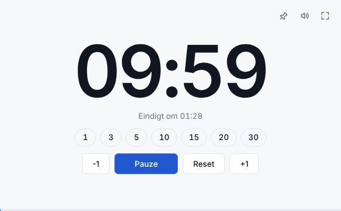
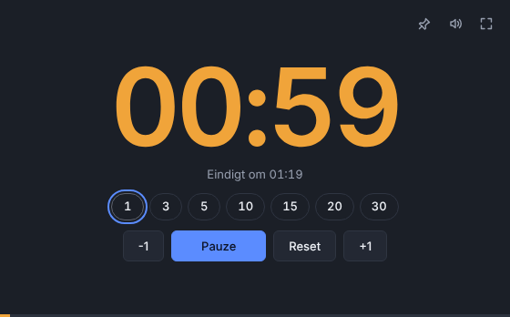

# Tijdvak (werktitel)

Een eigen timer-app voor Windows: voor lessen, werkvormen, vergaderingen en workshops.
Strak, modern, professioneel. Gebouwd met Tauri 2 + React + TypeScript.

## Versie 0.1 (basistimer, concept A "Mica")

 

- Grote cijfers, klik erop om een tijd te typen (`7`, `7:30`, `90s`, `1:05:00`)
- Snelle tijden: 1, 3, 5, 10, 15, 20, 30 minuten
- Start / Pauze / Verder, Reset, -1 en +1 minuut (ook scrollen op de cijfers)
- Oranje in de laatste minuut, rood na nul met doortellen (`+00:12`)
- Zacht eindsignaal, taakbalk licht op als het venster niet actief is
- Resterende tijd in de venstertitel (zichtbaar in de taakbalk)
- Altijd bovenop, volledig scherm (bediening verdwijnt na 2,5 s)
- Licht en donker volgen Windows; laatste tijd en voorkeuren worden onthouden

### Sneltoetsen
| Toets | Actie |
|---|---|
| Spatie | Start / pauze |
| R | Reset |
| + / - | Minuut erbij / eraf |
| Enter | Tijd typen |
| F / Esc | Volledig scherm aan / uit |
| T | Altijd bovenop |
| M | Geluid aan / uit |

## Installer downloaden
Elke push bouwt automatisch een Windows-installer (GitHub Actions, workflow "Windows build").
Ga naar **Actions**, open de laatste groene run, en download **Tijdvak-Windows-installer**.

## Zelf ontwikkelen
```bash
npm install
npm test          # tests van de timer-kern
npm run dev       # in de browser op http://localhost:1420
npm run app:dev   # als echte Windows-app (vereist Rust)
npm run app:build # installer maken (op Windows)
```

## Mappen
```
src/core/      timer-logica (pure TypeScript, getest, drift-vrij)
src/ui/        scherm (React)
src/platform/  Windows-functies via Tauri (venster, geluid)
src/settings/  voorkeuren
src-tauri/     Windows-app (Rust)
design/        ontwerpbord en concepten
docs/          werkplan
```
